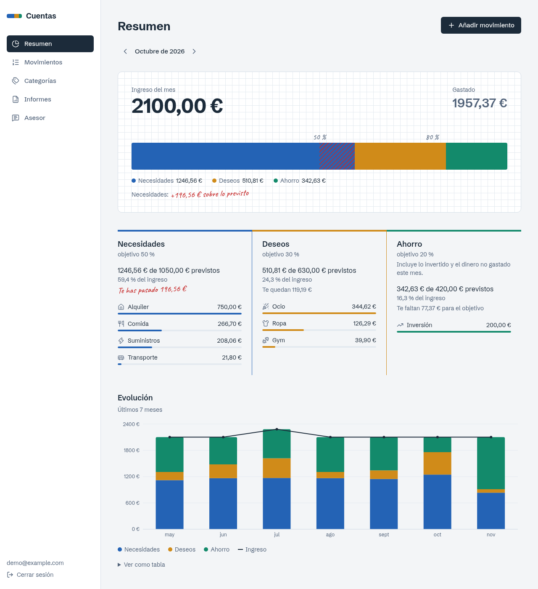
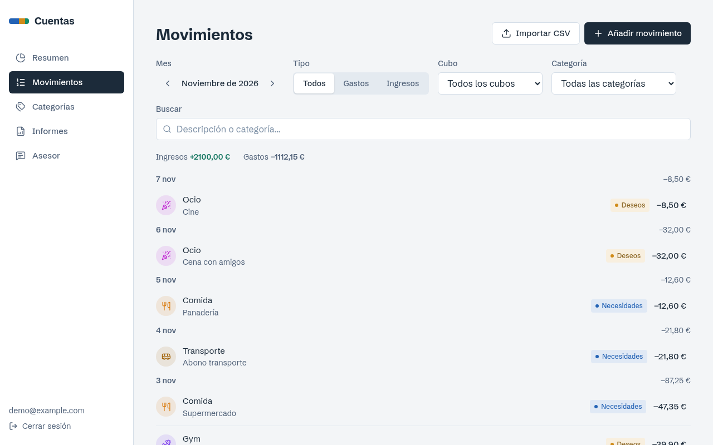
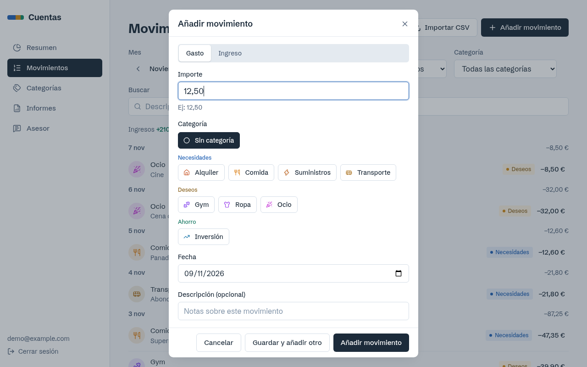
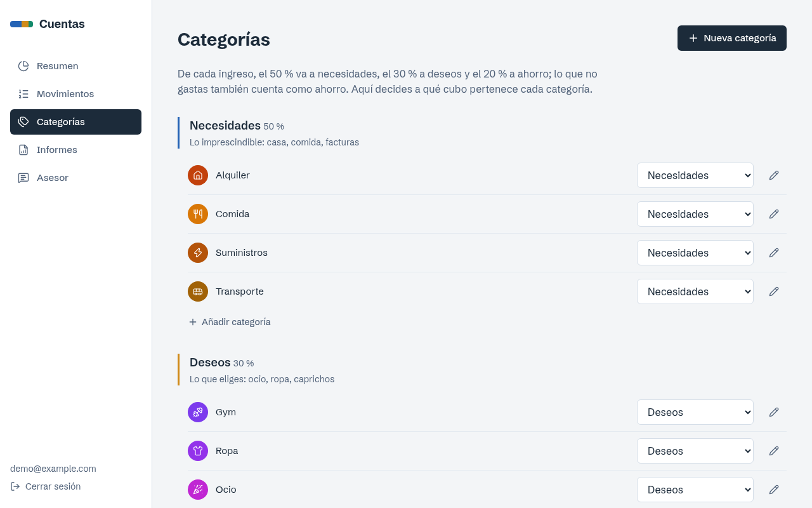
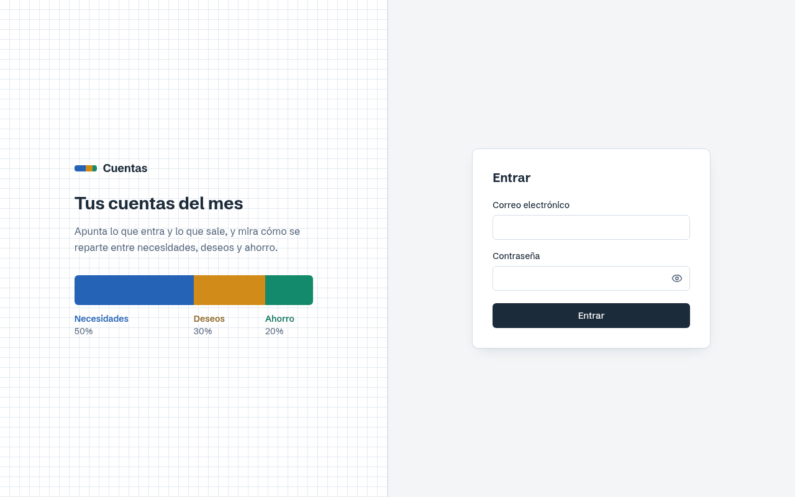
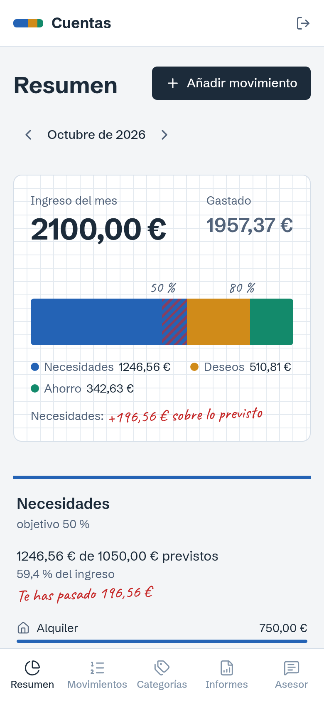
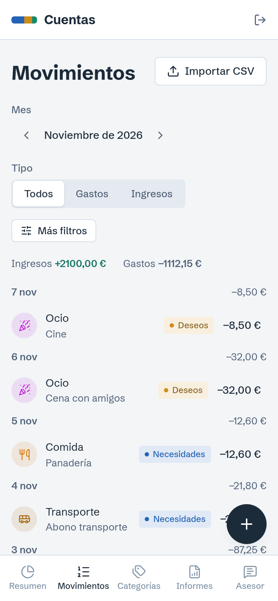

# Cuentas

Finanzas personales con la **regla 50/30/20**, para instalar en tu propio equipo. Apuntas o importas
lo que entra y lo que sale, y la app calcula cómo se reparte tu dinero entre **necesidades (50 %)**,
**deseos (30 %)** y **ahorro (20 %)**, y te avisa cuando una parte se pasa de su objetivo. Si quieres,
un LLM local analiza cada mes y responde preguntas sobre tus datos.

[Contrato de la API](docs/API.md) · [Asesor](docs/ASESOR.md) · [Conexión con el banco](docs/BANCO.md)



<sub>Capturas con datos ficticios, anteriores a Informes, Importar y Asesor, que aún no aparecen en ellas.</sub>

## Qué hace

- **Reparto del mes.** Tus ingresos se dibujan como una barra dividida con las marcas del objetivo
  50/30/20, y encima lo que realmente destinaste a cada parte. Si una parte se pasa, el exceso sale
  rayado y con una anotación a mano en rojo, como una corrección en una libreta.
- **Detalle por cubo.** Cuánto llevas frente a lo previsto, cuánto te queda o cuánto te has pasado, y
  en qué categorías se va el dinero.
- **Evolución.** Los últimos meses en barras apiladas, con la línea de ingresos encima.
- **Movimientos.** Alta rápida (escribes `12,50`, eliges una categoría y pulsas Enter), filtros por
  mes, tipo, cubo, categoría y texto, y una lista agrupada por días con subtotales.
- **Importar desde el banco.** Subes el CSV de tu banco, eliges qué columna es la fecha, el importe y
  el concepto, y ves una previsualización antes de confirmar. Reimportar un extracto que se solapa
  con otro no duplica nada, y la categoría se sugiere a partir de cómo categorizaste antes los
  movimientos con la misma descripción.
- **Informes.** Por semana, mes o año, con comparación con el periodo anterior, cubos frente a su
  objetivo, desglose por categoría, mayores movimientos y avisos automáticos. Se exportan a PDF y CSV.
- **Categorías editables.** Vienen de serie alquiler, comida, suministros, transporte, gym, ropa, ocio
  e inversión, además de nómina y extras como ingresos. Puedes cambiar el cubo de cualquiera en el
  sitio (¿el gym es una necesidad o un deseo? lo decides tú), crear nuevas con su icono y color, y
  archivar o borrar.
- **Asesor con IA local (opcional).** Analiza cada mes, responde preguntas y recuerda sus consejos para
  comprobar después si funcionaron.
- **Un solo usuario.** La primera cuenta que se registra es la única; después, el registro se cierra.
- **Adaptada a móvil.** Barra de navegación inferior, alta de movimientos a un toque y filtros plegables.

| Movimientos | Añadir un movimiento | Categorías |
|---|---|---|
|  |  |  |

| Acceso | Móvil: resumen | Móvil: movimientos |
|---|---|---|
|  |  |  |

## Cómo se calcula el 50/30/20

- La base son los **ingresos del mes**. Los tres objetivos se calculan en céntimos enteros y suman
  exactamente el ingreso: si ingresas 10,01 €, los objetivos son 5,00 € + 3,00 € + 2,01 €.
- Cada gasto va al cubo de su categoría.
- **El ahorro incluye lo que no gastas**:
  `ahorro = gastos en categorías de ahorro (inversión…) + max(0, ingresos − todos los gastos)`.
  Si solo contara lo que apuntas como inversión, alguien que ahorra sin registrarlo aparecería con un
  0 % de ahorro, y eso sería falso. En el mes en curso la app avisa de que esta cifra irá bajando
  hasta fin de mes.
- Los gastos sin categoría no cuentan en ningún cubo, pero sí reducen el ahorro.
- Resumen e informes usan la misma fórmula, así que dan la misma cifra para el mismo mes.

## Importación de extractos bancarios

Cualquier banco permite descargar un fichero CSV con los movimientos, pero no hay dos que usen el
mismo formato: cambian los nombres de columna, las fechas, los separadores decimales y los signos.
La importación está diseñada para absorber cualquier extracto sin duplicar movimientos al solapar meses.

- **Flujo en cuatro pasos.** Subida del fichero (detecta UTF-8 y Windows-1252), asignación de columnas
  con muestra real de filas, previsualización en el servidor y confirmación atómica en la base de datos.
  El mapeo de columnas se recuerda en el navegador por nombre de entidad, sin almacenar movimientos.
- **Idempotencia con huella anti-duplicados.** Cada apunte importado genera una huella (`import_ref`,
  migración `0003`) calculada a partir de la fecha, el importe, el tipo (ingreso o gasto), la descripción
  o referencia del extracto y su número de aparición en el fichero. Si descargas el extracto de los
  últimos tres meses cuando ya habías importado los dos anteriores, la app detecta los repetidos y solo
  crea los nuevos. La referencia bancaria sola no basta porque en recibos recurrentes se repite mes a mes.
- **Detección y resolución de fechas ambiguas.** Si un fichero tiene fechas como `03/04/2026`, puede ser
  3 de abril o 4 de marzo. El parser evalúa todas las filas del fichero: si una interpretación abarca un
  intervalo de fechas significativamente más coherente y estrecho, se selecciona automáticamente. Si ambas
  son plausibles, la API responde `422 ambiguous_date` y el asistente pide al usuario que elija el orden
  (día/mes o mes/día) en vez de arriesgarse a guardar fechas erróneas.
- **Formatos numéricos y multidivisa.** Soporta coma o punto decimal, separadores de miles con espacio o
  punto, signo negativo delante (`-12,50`), detrás (`12,50-`) o entre paréntesis, y tanto columnas de importe
  único con signo como columnas separadas para cargo y abono. Limpia símbolos (`€`, `$`) y códigos (`EUR`, `USD`).
- **Sugerencia de categorías.** Si en movimientos anteriores categorizaste "MERCADONA" como Comida, la
  previsualización sugiere automáticamente esa categoría para los movimientos con la misma descripción.
- **Protección contra ficheros hostiles.** Límite de 2 MB y 5.000 filas por fichero, conteo preliminar de
  separadores para descartar líneas degeneradas, análisis fuera del runtime asíncrono con `spawn_blocking` y
  saneamiento estricto de caracteres invisibles y bytes NUL (`\0`) que harían fallar a PostgreSQL.

## Asesor con IA local

**El código calcula y el modelo explica.** Rust obtiene las cifras exactas (resumen, informe, evolución)
y se las pasa al modelo, al que el prompt prohíbe usar cifras que no estén en esos datos.

- **Memoria con RAG.** Cada análisis y cada conversación se guardan con su embedding en pgvector. Al
  analizar un mes, el prompt incluye el análisis del mes anterior y las memorias más parecidas, y el
  modelo debe decir si seguiste sus consejos. Puedes ver y borrar cualquier recuerdo.
- **Aislado.** El servicio escucha solo en `127.0.0.1` con un token propio, no tiene acceso a la BD de
  finanzas y no dispone de herramientas que escriban. El `user_id` lo pone Rust a partir de la sesión.
- **Texto no fiable tratado como tal.** Las descripciones de los movimientos pueden venir de un banco o
  de terceros: van delimitadas como datos y el prompt ordena ignorar cualquier instrucción dentro.
- **Tus datos no salen.** Se usa Ollama en tu máquina. `OLLAMA_URL` solo admite esta máquina o `https`, y
  el servicio no arranca si detecta activadas las trazas de LangChain hacia LangSmith.
- **Para hardware modesto.** Un modelo de 4B cuantizado (unos 3,3 GB de memoria), una generación a la vez
  y análisis guardados en vez de recalculados. Un análisis tarda unos 90 s en una CPU moderna limitada a
  4 hilos y entre 8 y 13 s con una GPU dedicada de gama media.

Límite conocido: un modelo tan pequeño recibe cifras exactas, pero a veces las interpreta mal; por ejemplo,
confunde "% del gasto" con "% de los ingresos". Sus conclusiones son las de un asistente, no las de un informe.
Arquitectura, contrato interno y mediciones en [`docs/ASESOR.md`](docs/ASESOR.md).

## Arquitectura

```
navegador ──/api (proxy de Vite)──▶ backend Rust :8080 ──▶ PostgreSQL :5433
                                        │ cifras exactas y user_id de la sesión
                                        ▼ Bearer ASESOR_TOKEN
                                    asesor Node :8090 ──▶ Ollama :11434
                                        └───────────────▶ PostgreSQL + pgvector :5435
```

| Parte    | Tecnología |
|----------|------------|
| Frontend | Vite 8, React 19, TypeScript, Tailwind CSS v4, TanStack Query, Recharts, jsPDF |
| Backend  | Rust, axum 0.8, sqlx 0.9, tokio |
| Datos    | PostgreSQL 18 en contenedores de podman; las migraciones se aplican al arrancar |
| Sesión   | JWT en cookie `httpOnly` + `SameSite=Lax`; contraseñas con Argon2id |
| Asesor   | Node, TypeScript, LangChain.js, Ollama, pgvector |

## Decisiones técnicas

- **Dinero en enteros de céntimos.** Nunca en coma flotante, para que no haya errores de redondeo.
- **Mismo origen gracias al proxy.** Para el navegador, frontend y API son el mismo origen: la cookie de
  sesión funciona sin CORS y el token nunca está al alcance de JavaScript.
- **Reimportar sin duplicar.** Cada movimiento importado guarda una huella de fecha, importe, tipo y
  descripción o referencia del banco, más su n.º de aparición dentro del fichero. La referencia sola no
  basta: la de un recibo se repite cada mes.
- **Fechas ambiguas.** Si un CSV se puede leer como día/mes o como mes/día, la app solo decide cuando una
  lectura abarca claramente menos tiempo. Si no, te pide que elijas el formato en vez de adivinarlo.
- **CSV hostiles.** Como máximo 2 MB y 5.000 filas, con conteo previo de separadores, un fichero a la vez y
  fuera del runtime async: un fichero malicioso no dispara la memoria ni bloquea el servidor.
- **Inyección de fórmulas en exportaciones CSV.** Al exportar movimientos o categorías (`/api/reports/export.csv`),
  los campos que empiezan por `=`, `+`, `-` o `@` se neutralizan con una comilla simple (`'`) para evitar que
  Excel o LibreOffice Calc interpreten el texto como fórmulas dinámicas ejecutables.
- **Límites de importe y fecha contra desbordamiento.** Los movimientos limitan el importe a un máximo de
  1.000 millones de euros y las fechas al intervalo 2000-2100. Esto protege las agregaciones en PostgreSQL
  (`SUM(amount_cents)`) contra desbordamientos de `BIGINT` que dejarían el resumen del mes en 500.
- **Fórmula de ahorro unificada y transparente.** La definición de ahorro vive en una función pura compartida
  (`summary::calc::savings_cents`). Resumen, cubos e informes calculan exactamente lo mismo e informan del
  remanente no gastado (`unspent_cents`) tanto en pantalla como en el PDF descargable.
- **PDF vectorial generado en el navegador.** jsPDF dibuja el informe directamente en el cliente. Para no
  engordar la carga inicial de la aplicación, la librería se descarga mediante importación dinámica solo al
  pulsar el botón de exportación, y la página de informes reside en su propio chunk.
- **Anonimización de datos sensibles (PII) en el asesor.** Antes de indexar en pgvector o persistir recuerdos,
  un filtro sustituye IBANs, URLs, correos electrónicos, teléfonos y direcciones cripto por `[dato omitido]`,
  evitando que información bancaria confidencial contamine la memoria a largo plazo.
- **La BD es un servicio.** Si Postgres depende de una terminal o de un proceso suelto, el apagado del equipo
  puede cortarlo en mitad del checkpoint y corromper el clúster. Como servicio, systemd le envía SIGINT
  (apagado rápido y limpio) y espera a que termine antes de desmontar el almacenamiento del contenedor.
- **Aislamiento de procesos y señales en `dev.sh`.** Backend, frontend y asesor se lanzan en grupos de procesos
  separados (`setsid`). Si se pulsa Ctrl+C, un manejador envía SIGTERM a cada grupo y espera hasta 10 segundos
  antes de forzar SIGKILL, evitando procesos huérfanos que dejen puertos ocupados.

### Fallos que solo salieron probándolo de verdad

- La librería de JWT compilaba sin avisos, pero **hacía panic al firmar el primer token** porque le faltaba el
  backend criptográfico.
- Enter no enviaba el formulario de alta, porque el botón quedaba fuera del `<form>`.
- Los colores de Necesidades y Deseos eran **casi indistinguibles con protanopía** (ΔE 3,0). La paleta se rehízo
  y se validó (ΔE ≥ 11), y el texto se separó en variantes con contraste AA.
- La evolución dibujaba **una caída falsa a 0 €** en los meses anteriores al primer movimiento.
- La fuente separaba la coma decimal de las cifras ("2100 , 00 €").
- **Desbordamiento de `SUM(...)` en PostgreSQL con cifras grandes.** Al ingresar importes de prueba muy elevados,
  la suma agregada desbordaba `BIGINT` en la base de datos y devolvía 500 para todo el mes hasta vaciar los
  registros a mano. Se atajó con restricciones `CHECK` en SQL, validación en axum y límites en el formulario.
- **`PANIC` en el checkpoint de Postgres al apagar el equipo.** Si el contenedor corría dependiente de un proceso
  de terminal, systemd desmontaba `fuse-overlayfs` en paralelo mientras Postgres estaba cerrando transacciones.
  Convertir el contenedor en unidad Quadlet de systemd aseguró una parada ordenada con `SIGINT` de hasta 60 segundos.
- **Tres cifras de ahorro contradictorias para un mismo mes.** El resumen calculaba un 30 % (inversión más
  remanente), la tasa de ahorro de informes mostraba un 10 % (solo el neto) y el cubo de ahorro un 20 % (solo
  inversión). La fórmula se unificó en un único módulo y se explicitó el remanente no gastado en la interfaz.
- **Caracteres NUL (`\0`) y bytes invisibles en extractos bancarios.** Un extracto real con bytes nulos provocaba
  un error 500 no capturado al intentar persistir la descripción en PostgreSQL. Ahora las cadenas se limpian de
  caracteres de control e invisibles de formato antes de llegar a la base de datos.
- **Consumo persistente de CPU en Ollama tras cerrar la pestaña.** Si el usuario detenía la generación o cambiaba
  de pantalla, el backend cerraba la conexión HTTP pero Ollama continuaba computando tokens durante minutos. Se
  enlazó la desconexión del cliente HTTP con la cancelación de la petición en Ollama.

## Arrancar en local

Requisitos: Rust ≥ 1.94, Node 20.19+ o 22.12+ y podman con systemd. Para el asesor, además, Node ≥ 24.2 y
[Ollama](https://ollama.com).

```bash
git clone https://github.com/Chuwi12/cuentas.git && cd cuentas
cp .env.example .env
openssl rand -base64 48     # pega el resultado en JWT_SECRET dentro de .env
./scripts/db.sh install     # una sola vez: registra la BD como servicio de usuario de systemd
./scripts/dev.sh            # asegura la BD y arranca backend (:8080) y frontend (:5173)
```

Abre http://localhost:5173 y crea tu cuenta. Ctrl+C para backend y frontend a la vez; la BD sigue en marcha y
se para con `./scripts/db.sh down` (o sola, en orden, al apagar el equipo).

Para activar el asesor, pon en `ASESOR_TOKEN` (dentro de `.env`) la salida de otro `openssl rand -base64 48` y
ejecuta lo siguiente; desde entonces, `dev.sh` arranca también su BD y el servicio:

```bash
ollama pull qwen3.5:4b
ollama pull embeddinggemma:300m-qat-q8_0
./scripts/db.sh asesor install
```

`./scripts/db.sh [asesor] {install|uninstall|up|down|status|logs|psql|reset}` gestiona cada BD.

## Pruebas

| Comando | Qué comprueba |
|---|---|
| `cd backend && cargo test` | 149 tests unitarios |
| `python3 scripts/e2e.py` | 170 comprobaciones de la API con el backend en marcha, con las cifras del 50/30/20, de los informes y de la importación calculadas a mano. Se niega a correr si la BD ya tiene un usuario |
| `cd asesor && npm test && npm run check` | 57 tests y tipos. Los 3 de integración se saltan solos sin Postgres con pgvector y Ollama |
| `cd frontend && npx tsc -b && npx oxlint src` | Tipos y lint |

## Seguridad

- Contraseñas con Argon2id, de 12 caracteres como mínimo.
- La sesión va en una cookie `httpOnly`, así que un script inyectado no puede leerla.
- Toda consulta se filtra por usuario; un recurso ajeno responde 404, no 403.
- Tras 10 intentos fallidos con un mismo email, ese email se bloquea 15 minutos. Consecuencia asumida: quien
  conozca tu email podría bloquearte el acceso durante ese rato.

## Estado y limitaciones

Es una app para uso local o en una red de confianza, y todavía no está preparada para exponerla a internet:

- **No hay despliegue.** El backend solo sirve la API, así que el frontend necesita Vite.
- **Hace falta HTTPS delante y `COOKIE_SECURE=true`.** Sin HTTPS, la contraseña y la cookie viajarían en claro.
- **Las sesiones no se revocan.** Cerrar sesión borra la cookie, pero el token sigue siendo válido hasta que
  caduca (30 días por defecto, `SESSION_HOURS`).
- **Argon2 no tiene límite de concurrencia.** Muchos intentos de acceso simultáneos podrían agotar la memoria.
- **El banco solo entra por CSV.** La sincronización automática está analizada en
  [`docs/BANCO.md`](docs/BANCO.md), pero sin implementar.
- **Sin recuperación de contraseñas.** Al ser una instalación monousuario local, si olvidas la clave debes
  restablecerla directamente en la base de datos.
- **Monodivisa.** Todos los importes se registran en céntimos de la misma moneda; no soporta cambio entre divisas.
- **Sin CI y sin tests automáticos en el frontend.** Las pruebas de la tabla anterior se lanzan a mano.

## Estructura

```
backend/
  src/auth/          registro, login, sesión, límite de intentos
  src/categories/    CRUD de categorías
  src/transactions/  CRUD de movimientos con filtros y paginación
  src/summary/       cálculo 50/30/20 (lógica pura en calc.rs) y consultas
  src/reports/       informes y exportación CSV
  src/import/        importación de CSV (el análisis del fichero, sin BD, en parse.rs)
  src/asesor/        API del asesor: datos exactos y proxy al servicio
  migrations/        esquema SQL
asesor/              servicio del asesor: Node + LangChain.js + Ollama + pgvector
frontend/
  src/pages/         una carpeta por pantalla
  src/components/    primitivas de UI compartidas
  src/lib/           cliente de API, dinero, fechas, cubos, iconos, sesión
  src/styles/        tokens de diseño
deploy/              servicios Quadlet de las dos BD
docs/                contrato de API, asesor, análisis del banco y capturas
scripts/             base de datos, arranque y prueba de punta a punta
```
